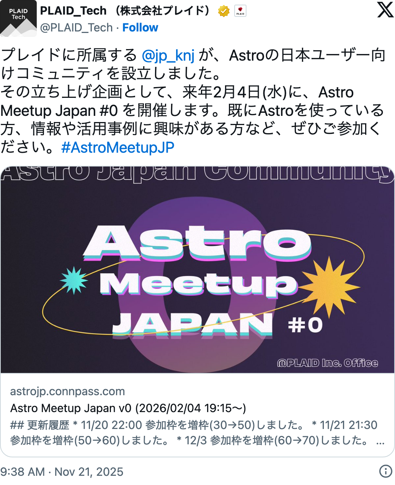
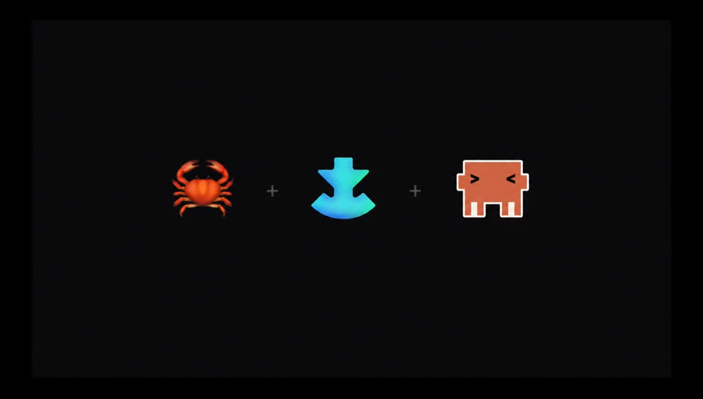
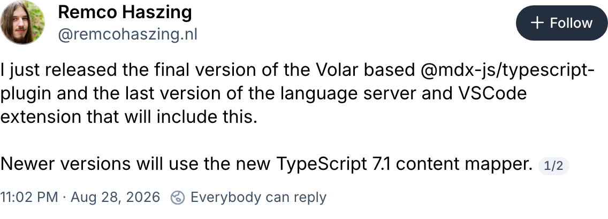
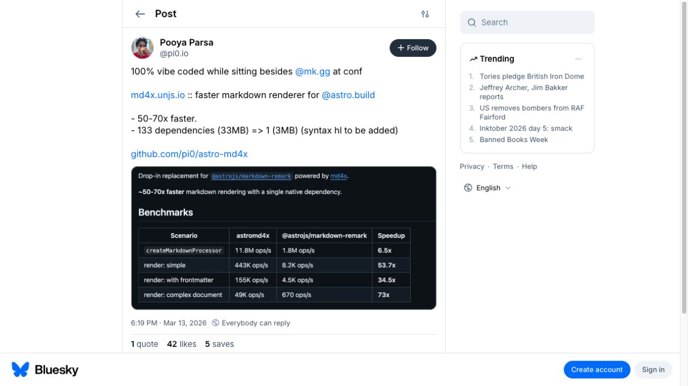
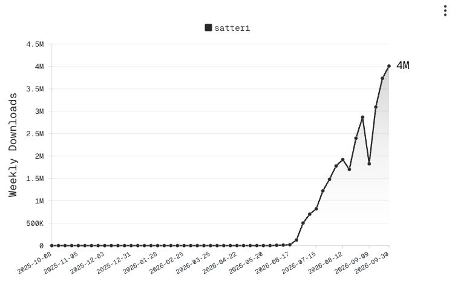

<h1 class="!text-5xl !font-700 leading-tight">
  Astro と Rust で考える<br />フロントエンドツールチェーンの今
</h1>

<div class="text-2xl text-black mt-10">Vue Fes 2026</div>

<div class="text-2xl text-black mt-3">kenji(jp-knj)</div>

<!--
予定時刻：00:00 から 00:09（9 秒）
発話 62 文字。時間は予定であり、実測ではない。
進行：クリックなし。発話後に次へ進む。

### 発話

今日は Astro Compiler を題材に、動いていたツールチェーンを、なぜ書き直すのか、という話をわたしの視点でお話します。
-->

---
class: flex items-center justify-center h-full
---

<div class="grid grid-cols-2 gap-10">
  <div>
    <div class="flex items-center gap-4">
      
      <div class="flex flex-col justify-center gap-0">
        <p class="text-2xl !my-0">ケンジ</p>
        <p class="text-xl !my-0">GitHub: <a href="https://github.com/jp-knj">jp-knj</a></p>
      </div>
    </div>
  </div>
  <div>
    <ul class="text-xl">
      <li>Astro Maintainer</li>
      <li>Astro Japan Community</li>
    </ul>
  </div>
</div>

<!--
予定時刻：00:09 から 00:19（10 秒）
発話 55 文字。時間は予定であり、実測ではない。
進行：クリックなし。発話後に次へ進む。

### 発話

自己紹介です。Astro のメンテナとして活動していて、Astro Japan Community も運営しています。

### 確認メモ（発表では話さない）

自己紹介は本人が共有した内容に限定する。


### 出典と確認資料（発表では話さない）

- [jp-knj](https://github.com/jp-knj)
-->

---
layout: default
class: community-story
---

## Vue Fes 2025 から Astro Japan Community へ

<ol class="community-thread" data-community-step="thread">
  <li class="thread-post thread-continues">
    <span class="thread-avatar avatar-pilcrow" aria-hidden="true"></span>
    <div>
      <p class="thread-meta"><a href="https://x.com/pilcrowonpaper" target="_blank" rel="noreferrer"><b>pilcrow</b> @pilcrowonpaper</a></p>
      <p class="thread-text">Why isn’t anyone from @astrodotbuild here at @vuefes :(</p>
    </div>
  </li>
  <li class="thread-post thread-continues">
    <span class="thread-avatar avatar-astro" aria-hidden="true"></span>
    <div>
      <p class="thread-meta"><a href="https://x.com/astrodotbuild" target="_blank" rel="noreferrer"><b>Astro</b> @astrodotbuild</a></p>
      <p class="thread-text">@jp_knj was there!</p>
    </div>
  </li>
  <li class="thread-post thread-continues">
    <span class="thread-avatar avatar-pilcrow" aria-hidden="true"></span>
    <div>
      <p class="thread-meta"><a href="https://x.com/pilcrowonpaper" target="_blank" rel="noreferrer"><b>pilcrow</b> @pilcrowonpaper</a></p>
      <p class="thread-text">We need more people!</p>
    </div>
  </li>
  <li class="thread-post">
    <span class="thread-avatar avatar-astro" aria-hidden="true"></span>
    <div>
      <p class="thread-meta"><a href="https://x.com/astrodotbuild" target="_blank" rel="noreferrer"><b>Astro</b> @astrodotbuild</a></p>
      <p class="thread-text">Who is organizing Astro meetups in Japan?</p>
    </div>
  </li>
</ol>

<!--
予定時刻：00:19 から 00:48（29 秒）
発話 171 文字。時間は予定であり、実測ではない。
進行：クリックなし。発話後に次へ進む。

### 発話

実は、Astro Japan Community を立ち上げたきっかけが、去年の Vue Fes だったんですね。Astro の認証まわりにも貢献した方。学生で。Lucia を開発した pilcrow ですね。Vue Fes に Astro の人はいないのか、と投稿したんです。そこから、コアメンバーも交えて、日本の Meetup は誰がやるんだろう、という話になりました。

### 確認メモ（発表では話さない）

学生という紹介は、発表者が今回の練習で共有した内容に基づく。Lucia は認証ライブラリとしての活動を紹介する。Astro との関係は、本人が公開した Astro DB adapter などで確認できる。
画面の投稿は原文の引用。投稿の日時と出典と画像の撮影方法は images/community/README.md を参照する。


### 出典と確認資料（発表では話さない）

- [2025-10-25 16:12](https://x.com/pilcrowonpaper/status/1981982063650812385)
- [2025-10-26 04:02](https://x.com/astrodotbuild/status/1982160958450520242)
- [2025-10-26 10:32](https://x.com/pilcrowonpaper/status/1982259070112292924)
- [2025-10-27 01:25](https://x.com/astrodotbuild/status/1982483654858441181)
- [pilcrow の GitHub](https://github.com/pilcrowonpaper)
- [Lucia と Astro DB を組み合わせる実装](https://github.com/pilcrowonpaper/lucia-adapter-astrodb)
- [Lucia の Astro での利用例](https://v2.lucia-auth.com/getting-started/astro/)
-->

---
layout: default
class: community-story
---

## Vue Fes 2025 から Astro Japan Community へ

<div class="community-state" data-community-step="meetup">
  <a class="community-post" href="https://x.com/PLAID_Tech/status/1991667457032089615" target="_blank" rel="noreferrer" aria-label="PLAID の開催告知を開く">
    
  </a>
  <p class="community-caption">コミュニティを設立し、PLAID で Meetup を開催</p>
  <a class="community-source" href="https://x.com/PLAID_Tech/status/1991667457032089615" target="_blank" rel="noreferrer">PLAID の開催告知を見る</a>
</div>

<!--
予定時刻：00:48 から 01:04（16 秒）
発話 95 文字。時間は予定であり、実測ではない。
進行：クリックなし。発話後に次へ進む。

### 発話

そこで僕が手を挙げて、コミュニティを立ち上げ、Meetup も開催しました。そのきっかけになった Vue Fes に、今年は登壇者として参加しています。Astro のコアメンバーも登壇してくれました。

### 確認メモ（発表では話さない）

投稿の日時と出典と画像の撮影方法は images/community/README.md を参照する。


### 出典と確認資料（発表では話さない）

- [PLAID の開催告知](https://x.com/PLAID_Tech/status/1991667457032089615)
-->

---
layout: statement
class: flex flex-col justify-center h-full intro-question
---

# Go で動いていたものを、<br />なぜ、Rust に書き直すのか？

<a class="intro-question-video" href="https://www.youtube.com/live/wZ3OZh9IP54?t=7644" target="_blank" rel="noreferrer" aria-label="Vue Amsterdam での Matt Kane の発表動画を開く">
  <figure class="intro-question-screenshot">
    
    <figcaption>Vue Amsterdam の発表動画</figcaption>
  </figure>
</a>

<!--
予定時刻：01:04 から 01:16（12 秒）
発話 86 文字。時間は予定であり、実測ではない。
進行：クリックなし。発話後に次へ進む。

### 発話

Matt は Vue Amsterdam で、Astro Compiler を Rust で書き直した話をしていました。
今日は、なぜ Go から Rust へ書き直すのか、その背景を掘り下げます。
-->

---
layout: default
class: body-center
---

## 話すこと

<div class="grid grid-cols-1 gap-4 mt-10">
  <div>
    <div class="text-3xl font-600 mt-1" style="color: var(--astro-heading)">1. 当時の判断</div>
    <div class="text-lg mt-2">なぜ最初に Go を選んだのか</div>
  </div>
  <div>
    <div class="text-3xl font-600 mt-1" style="color: var(--astro-heading)">2. 発見した問題</div>
    <div class="text-lg mt-2">使い続けるなかで何が見えたのか</div>
  </div>
  <div>
    <div class="text-3xl font-600 mt-1" style="color: var(--astro-heading)">3. 前提の変化</div>
    <div class="text-lg mt-2">2026年までに周囲はどう変わったのか</div>
  </div>
  <div>
    <div class="text-3xl font-600 mt-1" style="color: var(--astro-heading)">4. 新しい判断</div>
    <div class="text-lg mt-2">その結果、責務をどう分け直したのか</div>
  </div>
</div>

<!--
予定時刻：01:16 から 01:30（14 秒）
発話 115 文字。時間は予定であり、実測ではない。
進行：クリックなし。発話後に次へ進む。

### 発話

当時、なぜ Go を選んだのか。使い続けて、どんな問題が分かったのか。その間に、利用できる技術はどう変わったのか。最後に、どんな判断で書き直すのか。この４つの視点で歴史を紐解いていこうかなと思っています。
基礎的な用語の解説は省きます。
-->

---
layout: section
---

# 1. 当時の判断
## なぜ最初に Go を選んだのか

<!--
予定時刻：01:30 から 01:35（5 秒）
発話 22 文字。時間は予定であり、実測ではない。
進行：クリックなし。発話後に次へ進む。

### 発話

まず、Astro が Go を選んだときの話です。
-->

---
layout: default
class: ch1-start
---

## Astro 0.x の出発点

<div class="flex flex-col gap-8">
  <Overview
    visible="source,compiler,build,browser"
    :labels="{ compiler: 'Svelte Compiler', build: 'Snowpack' }"
    :icons="{ compiler: 'svelte', build: 'snowpack' }"
    :subnotes="{ compiler: 'fork を拡張', build: 'ビルドと配信' }"
  />
  <div class="text-2xl">Astro の構文を変換し、ビルド基盤へ渡す</div>
</div>

<Ref href="https://www.youtube.com/watch?v=bmWQqAKLgT4&amp;t=460s">VITE: The Documentary（Snowpack の話は 7:40 から）</Ref>

<!--
予定時刻：01:35 から 01:56（21 秒）
発話 144 文字。時間は予定であり、実測ではない。
進行：クリックなし。発話後に次へ進む。

### 発話

まず、Compiler とビルド基盤の役割を分けて見ます。初期の Astro は Svelte Compiler の fork で構文を変換し、Snowpack でビルドと開発中の配信を行っていました。この Compiler を書き直すとき、どんな言語を選べたんでしょうか。背景は下の動画でも紹介されています。

### 確認メモ（発表では話さない）

Svelte の fork は Compiler の実装。Snowpack はビルドを担当する。
配信は開発サーバーからブラウザへのファイル配信を指す。Snowpack の開発中の動作を説明し、本番環境でのサイト公開やホスティングとは区別する。
CultRepo の VITE: The Documentary は確認資料。動画の概要欄で、7 分 40 秒から Snowpack との比較、20 分 21 秒から Astro の Vite 採用を扱うことを確認した。このページの下端に、7 分 40 秒から再生するリンクを表示する。Vite の採用経緯は 10 ページのトークスクリプトで話す。

### 話す場合の補足（任意）

Astro のビルド基盤は、Snowpack から Vite へ移行しました。Vite の改善や Rollup のプラグインを、Astro でも利用できるようになるからです。

### 補足の確認事項（発表では話さない）

Snowpack と Vite は、図の Build の役割を担う基盤。Astro 0.21 では、ビルド基盤を Snowpack から Vite へ移行した。同時期に行った、Svelte Compiler の fork から Go Compiler への移行とは担当が異なる。
Vite の採用理由として、当時の記事は保守と資料の充実、性能、エラーメッセージ、コミュニティと Rollup のプラグインを挙げている。改善を複数のフレームワークで共有できることも説明している。
この補足は、利用できる基盤を選び直すという講演の主題につながる。本編の時間に合わせて省略できる。任意の補足は発話文字数に含めていない。


### 出典と確認資料（発表では話さない）

- [Snowpack から Vite への移行の説明](https://astro.build/blog/astro-021-preview/)
- [VITE: The Documentary（CultRepo）](https://www.youtube.com/watch?v=bmWQqAKLgT4)
- [Astro が Vite を採用した経緯（20 分 21 秒から）](https://www.youtube.com/watch?v=bmWQqAKLgT4&t=1221s)
- [Astro 初期の Compiler とビルド基盤](https://astro.build/blog/astro-021-release/)
- [Snowpack の開発サーバー](https://www.snowpack.dev/concepts/dev-server)
- [Snowpack のファイル単位の更新](https://www.snowpack.dev/concepts/how-snowpack-works)
-->

---
layout: default
class: body-center
---

## 2021 年、Go と Rust が選ばれていた

<div class="mt-12 relative">

  <!-- 軸。ドットの中心（上から 50px）に合わせて引く -->
  <div class="absolute left-0 right-0 top-[50px] h-[2px] bg-[#D9D3E2]"></div>

  <div class="relative flex items-start">
    <div class="flex-1 min-w-0 flex flex-col items-center">
      <div class="text-3xl text-black h-11 leading-none">Feb</div>
      <div class="w-3.5 h-3.5 rounded-full bg-[#9A90AB]"></div>
      <logos-vitejs class="text-6xl mt-8" />
      <div class="text-xl mt-5 leading-snug">Vite 2.0</div>
      <div class="text-xl mt-1 h-7 leading-7">esbuild を利用</div>
      
    </div>
    <div class="flex-1 min-w-0 flex flex-col items-center">
      <div class="text-3xl text-black h-11 leading-none">Sep</div>
      <div class="w-3.5 h-3.5 rounded-full bg-[#9A90AB]"></div>
      <logos-rome-icon class="text-6xl mt-8" />
      <div class="text-xl mt-5 leading-snug">Rome</div>
      <div class="mt-1 h-7" aria-hidden="true"></div>
      
    </div>
    <div class="flex-1 min-w-0 flex flex-col items-center">
      <div class="text-3xl text-black h-11 leading-none">Oct</div>
      <div class="w-3.5 h-3.5 rounded-full bg-[#9A90AB]"></div>
      <logos-parcel-icon class="text-6xl mt-8" />
      <div class="text-xl mt-5 leading-snug">Parcel 2</div>
      <div class="mt-1 h-7" aria-hidden="true"></div>
      
    </div>
    <div class="flex-1 min-w-0 flex flex-col items-center">
      <div class="text-3xl text-black h-11 leading-none">Oct</div>
      <div class="w-3.5 h-3.5 rounded-full bg-[#9A90AB]"></div>
      <logos-nextjs-icon class="text-6xl mt-8" />
      <div class="text-xl mt-5 leading-snug">Next.js 12</div>
      <div class="mt-1 h-7" aria-hidden="true"></div>
      
    </div>
    <div class="flex-1 min-w-0 flex flex-col items-center">
      <div class="text-3xl text-primary font-700 h-11 leading-none">Nov</div>
      <div class="w-5 h-5 rounded-full bg-[#BC52EE] -mt-[3px]"></div>
      <logos-astro-icon class="text-6xl mt-8" />
      <div class="text-xl mt-5 leading-snug text-primary font-600">Astro 0.21</div>
      <div class="mt-1 h-7" aria-hidden="true"></div>
      
    </div>
    <div class="flex-1 min-w-0 flex flex-col items-center">
      <div class="text-3xl text-black h-11 leading-none">Dec</div>
      <div class="w-3.5 h-3.5 rounded-full bg-[#9A90AB]"></div>
      <logos-turborepo-icon class="text-6xl mt-8" />
      <div class="text-xl mt-5 leading-snug">Turborepo</div>
      <div class="mt-1 h-7" aria-hidden="true"></div>
      
    </div>
  </div>
</div>

<!--
予定時刻：01:56 から 02:10（14 秒）
発話 83 文字。時間は予定であり、実測ではない。
進行：クリックなし。発話後に次へ進む。

### 発話

2021 年には Rust を採用するツールが増えていました。一方、Vite が使う esbuild や当時の Turborepo は Go です。Go も実績のある選択肢だったんですね。

### 確認メモ（発表では話さない）

Vite 自体を Go で実装したという説明ではない。製品の採用時期は参照資料に基づく。
-->

---
layout: default
class: go-era-slide go-era-build
---

<div class="go-era-heading">
  <h2>Astro v1 の構成</h2>
  <span class="go-era-year">2022 年</span>
</div>

<div class="go-era-body">
  <div class="go-era-summary">Compiler は Go、ビルド基盤は Vite</div>

  <Overview
    visible="source,compiler,build,browser"
    era="go"
    :subnotes="{ build: 'Rollup\nesbuild' }"
    :term-markers="{ 'html5-parser': true }"
  />

  <div class="go-era-reason">
    <div class="text-2xl font-600 text-primary">Nate Moore が挙げた Go の選定理由</div>
    <div class="text-xl mt-2">esbuild が Go だった。Go は学びやすかった。</div>
  </div>
</div>

<TermNotes  :notes="['Parser は、コードを文法に沿ってパースし、木などのデータにするプログラム。']">
<Ref inline>
  <li><a href="https://natemoo.re/posts/hello-from-the-other-side/" target="_blank" rel="noreferrer">Nate Moore: Hello from the other side</a></li>
  <li><a href="https://www.youtube.com/watch?v=bmWQqAKLgT4&amp;t=1221s" target="_blank" rel="noreferrer">VITE: The Documentary（Astro の Vite 採用は 20:21 から）</a></li>
</Ref>
</TermNotes>

<!--
予定時刻：02:10 から 03:00（50 秒）
発話 283 文字。時間は予定であり、実測ではない。
進行：クリックなし。発話後に次へ進む。

### 発話

Astro は 2021 年の 0.21 で Go Compiler と Vite に移行し、v1 でもこの構成を使いました。Compiler が Astro の構文を変換し、Vite がビルドを担当します。Vite の改善や Rollup のプラグインを利用できることも、採用理由の一つでした。
Nate Moore は、esbuild が Go だったことと、学びやすさを理由に挙げています。
実装では HTML5 Parser の fork と、esbuild 由来の CSS Parser を利用していました。僕は、参考になる実装を利用できた点にも納得しています。ここからは、この Compiler を使い続けて分かった問題です。

### 確認メモ（発表では話さない）

Go の経験者だったという理由へ変更しない。Compiler 内の esbuild は CSS の解析と生成、Vite の部分の esbuild は TypeScript の変換を担当する。HTML5 Parser 由来の実装を Astro Template Syntax に対応させた。原文は "esbuild was written in Go and it was easy to learn. We didn't overthink it." で、深い技術的判断として語らない。`internal/parser.go` と `internal/token.go` は `golang.org/x/net/html` の fork（Copyright The Go Authors）。JavaScript は `tdewolff/parse` による走査（`internal/js_scanner`）だけで、完全な JS Parser はない。


### 出典と確認資料（発表では話さない）

- [esbuild の CSS Parser の導入](https://github.com/withastro/compiler/pull/329)
- [Astro v1 の Vite plugin](https://github.com/withastro/astro/blob/astro%401.0.0/packages/astro/src/vite-plugin-astro/index.ts)
- [Go Compiler と Vite を採用した Astro v0.21](https://astro.build/blog/astro-021-release/)
- [Nate Moore: Hello from the other side](https://natemoo.re/posts/hello-from-the-other-side/)
-->

---
layout: section
---

# 2. 発見した問題
## 使い続けるなかで何が見えたのか

<!--
予定時刻：03:00 から 03:06（6 秒）
発話 31 文字。時間は予定であり、実測ではない。
進行：クリックなし。発話後に次へ進む。

### 発話

まず構文の挙動、次に編集ツールが必要とする情報を見ていきます。
-->

---
layout: default
class: syntax-overview body-center
clicks: 6
---

## Astro Template Syntax

````md magic-move
```astro
---
const products = await getProducts();
---
```
```astro
---
const products = await getProducts();
---

<ul>
  <!-- template -->
</ul>
```
```astro
---
const products = await getProducts();
---

<ul>
  {products.map((product) => (
    <li>{product.name}: {product.price}</li>
  ))}
</ul>
```
```astro {3,7}
---
const products = await getProducts();
const props = { title: "second" };
---
<ul>
  {products.map((product) => (
    <li title="first" {...props}>{product.name}</li>
  ))}
</ul>
```
````

<div class="mt-0 text-center text-2xl">
  <div v-if="$clicks === 0"><span class="text-primary font-600">Component script</span><br /><code>---</code> で囲む。ビルド時とサーバーで実行する JavaScript と TypeScript</div>
  <div v-if="$clicks === 1"><span class="text-primary font-600">Template</span><br />HTML を基礎に、JavaScript expression や<br />コンポーネントを書ける</div>
  <div v-if="$clicks === 2"><span class="text-primary font-600">JavaScript expression</span><br />Astro の書き方って、JSX っぽいですよね。</div>
  <div v-if="$clicks === 3"><span class="text-primary font-600">Q. </span>この <code>title</code> は、どちらの値になる？</div>
  <div v-if="$clicks === 3" class="mt-4"><code>first</code> か、<code>second</code> か</div>
  <div v-if="$clicks === 4"><span class="text-primary font-600">A. </span><code>first</code></div>
  <Overlay v-if="$clicks >= 5" aria-label="Astro Template Syntax への問いと答え">
    <template #title>
      <span v-if="$clicks === 5">JSX なら second。なぜ first になった？</span>
      <span v-else>HTML の規則で扱ったため</span>
    </template>
    <p v-if="$clicks >= 6">
      <strong>同じタグに同じ名前の属性が複数あれば、後の属性を捨てる。</strong>
    </p>
    <template v-if="$clicks >= 6" #reference>
      <a href="https://html.spec.whatwg.org/multipage/parsing.html#attribute-name-state" target="_blank" rel="noopener noreferrer">HTML Standard：同じ名前の属性は後のものを取り除く</a>
    </template>
  </Overlay>
</div>

<Ref v-if="$clicks < 3" href="https://docs.astro.build/en/reference/astro-syntax/">Astro Template Syntax</Ref>
<Ref v-if="$clicks === 4" href="https://github.com/withastro/astro/issues/5558#issuecomment-1343799494">astro#5558 の説明</Ref>

<!--
予定時刻：03:06 から 04:16（70 秒）
発話 389 文字。時間は予定であり、実測ではない。
進行：6 回のクリックを発話に合わせる。

### 発話

[初期表示]
まず Astro の書き方です。三本線で囲まれた部分が Component script です。JavaScript と TypeScript を書けて、ビルド時やサーバーで実行します。
[クリック 1]
その下が Template です。HTML を基礎に、表示する内容を書きます。
[クリック 2]
波かっこの中で JavaScript expression を評価します。ここでは、名前と価格を表示しています。Astro の書き方って、JSX っぽいですよね。
[クリック 3]
li の title に first を指定して、その後に title が second の props を展開します。JSX のつもりなら second ですよね。Astro では、first だと思う人。second だと思う人。
[クリック 4]
答えは first です。
[クリック 5]
なぜ、後の指定が優先されなかったんでしょうか。
[クリック 6]
この例では、Astro は title 属性を二つ含む HTML を生成します。ブラウザは重複した属性の先のものを採用します。

### 確認メモ（発表では話さない）

2022 年の報告は class 属性について。このスライドでは title 属性に簡略化している。2026 年 10 月 7 日に Astro 7.3.6 でビルドし、title="first" の後に {...props} を書くと、生成した HTML に title="first" title="second" が含まれることを確認した。順番を逆にすると title="second" title="first" になった。Go Compiler 2.12.2 の変換結果も、title="first" と $$spreadAttributes(props) を別々に出力している。この例を過去だけの挙動として扱わない。class 属性には特別な規則があるため、すべての属性に一般化しない。HTML の重複属性と、JSX で後の指定を優先する props の合成を区別する。発話では JavaScript expression に統一する。Astro AST の expression node は波かっこを含む領域を指すため、その中の JavaScript expression と区別する。


### 出典と確認資料（発表では話さない）

- [astro#5558 の説明](https://github.com/withastro/astro/issues/5558#issuecomment-1343799494)
- [Astro Template Syntax](https://docs.astro.build/en/reference/astro-syntax/)
- [HTML Standard の attribute name state](https://html.spec.whatwg.org/multipage/parsing.html#attribute-name-state)
-->

---
layout: default
class: body-center
clicks: 2
---

## Astro Template Syntax

```astro
<span>Astro</span>
<span>1200</span>
```

<!-- クイズと答えの表示領域を固定し、空白の説明は Overlay で表示する -->
<div class="mt-4 h-[96px] flex flex-col items-center justify-center text-center text-2xl">
  <div v-if="$clicks === 0"><span class="text-primary font-600">Q. </span>このコードは、どちらの表示になる？</div>
  <div v-if="$clicks === 0" class="mt-4"><code>Astro 1200</code> か、<code>Astro1200</code> か</div>
  <div v-if="$clicks === 1"><span class="text-primary font-600">A. </span><code>Astro 1200</code></div>
  <Overlay v-if="$clicks >= 2" aria-label="Astro Template Syntax の空白の扱い">
    <template #title>
      ブラウザが空白にする
    </template>
    <p>
      要素間の改行を HTML に保持した。<br />
      ブラウザがその改行を空白として表示し、<code>Astro 1200</code> になった。
    </p>
    <template #reference>
      <a href="https://github.com/withastro/astro/issues/6011" target="_blank" rel="noopener noreferrer">astro#6011: 要素間の空白テキスト node</a>
      <a href="https://blog.dwac.dev/posts/html-whitespace/" target="_blank" rel="noopener noreferrer" class="ml-8">HTML Whitespace is Broken</a>
    </template>
  </Overlay>
</div>

<!--
予定時刻：04:16 から 04:46（30 秒）
発話 101 文字。時間は予定であり、実測ではない。
進行：2 回のクリックを発話に合わせる。

### 発話

[初期表示]
二つの span を改行して並べます。JSX なら Astro1200 と続けて表示されますよね。
[クリック 1]
2023 年の報告では、空白が入りました。
[クリック 2]
Astro が改行を HTML に保持し、ブラウザが空白として表示していました。

### 確認メモ（発表では話さない）

2023 年の報告。既定の CSS の空白規則を前提とする。この空白の話は HTML correction と別の論点。関連ページで Astro v7 の設定の変更へ戻る。


### 出典と確認資料（発表では話さない）

- [astro#6011: 要素間の空白テキスト node](https://github.com/withastro/astro/issues/6011)
- [参照資料 2](https://blog.dwac.dev/posts/html-whitespace/)
-->

---
layout: default
class: table-comparison body-center code-example-compact
clicks: 2
---

## Astro Template Syntax

<div>

<div class="flex gap-8 w-full">
  <div class="min-w-0 code-split" :class="$clicks >= 1 ? 'w-[calc(50%-1rem)]' : 'w-full'">
    <div class="text-primary font-600 text-xl mb-1 flex items-center gap-2"><logos-astro-icon class="w-5 h-5 shrink-0" aria-hidden="true" />.astro</div>

```astro {4}
<table>
  <tr><td>{'foo'}</td></tr>
</table>
<h2>Chats</h2>
```

  </div>
  <Transition name="reveal-right">
  <div class="min-w-0 w-[calc(50%-1rem)]" v-if="$clicks >= 1">
    <div class="text-primary font-600 text-xl mb-1 flex items-center gap-2"><logos-html-5 class="w-5 h-5" />生成された HTML</div>

```html {3}
<table>
  <tr><td>foo</td></tr>
  <h2>Chats</h2>
</table>
```

  </div>
  </Transition>
</div>

<Overlay v-if="$clicks >= 2" aria-label="HTML の規則と Compiler の担当範囲">
  <template #title>
    HTML の規則による補正
  </template>
  <div>
    <p>Go Compiler は HTML5 Parser を拡張し、<br />ビルド時にもタグの補完と入れ子の補正を担っていた。</p>
  </div>
  <template #reference>
    <a href="https://github.com/withastro/compiler/issues/870" target="_blank" rel="noopener noreferrer">compiler#870 の不具合報告</a>
    <a href="https://html.spec.whatwg.org/multipage/parsing.html#tree-construction" target="_blank" rel="noopener noreferrer" class="ml-8">HTML Standard のパース規則</a>
  </template>
</Overlay>

</div>

<Ref v-if="$clicks < 2" href="https://github.com/withastro/compiler/issues/870">compiler#870</Ref>

<!--
予定時刻：04:46 から 05:36（50 秒）
発話 183 文字。時間は予定であり、実測ではない。
進行：2 回のクリックを発話に合わせる。

### 発話

[初期表示]
次は表の中に expression を含む例です。h2 は table の後に書いてあります。
[クリック 1]
ところが、生成した HTML では h2 が表の中に入っています。
[クリック 2]
これは、expression の後にタグの親子関係を間違えた不具合です。HTML の規則による補正ではありません。
Go Compiler は HTML5 Parser を拡張していて、ビルド時にもタグの補完と入れ子の補正を担っていました。

### 確認メモ（発表では話さない）

compiler#870 と修正 PR #925。この例で h2 が table に入った直接の理由は、波かっこの領域の終了時にパースの状態を戻せなかった不具合。修正は resetInsertionMode() でパースの状態を選び直すもの。Compiler が生成した誤った HTML と、Browser がそれを補正して作る DOM は区別する。このスライドは前者を示す。

補足としてのみ紹介する。HTML Standard の Take a deep breath は、sarcasm という名前の終了タグについての一文。sarcasm は皮肉という意味で、文面はジョークとして理解できる。その後は他の終了タグと同じ規則に従う。表の不具合の原因を説明する文ではない。原文の画像と出典は images/html-spec/README.md を参照する。


### 出典と確認資料（発表では話さない）

- [JavaScript expression を含む表のパースを修正した PR #925](https://github.com/withastro/compiler/pull/925)
- [compiler#870](https://github.com/withastro/compiler/issues/870)
- [HTML Standard：Tree construction](https://html.spec.whatwg.org/multipage/parsing.html#tree-construction)
- [HTML Standard：The "in body" insertion mode](https://html.spec.whatwg.org/multipage/parsing.html#parsing-main-inbody)
-->

---
layout: default
class: go-era-slide go-era-tools
---

<div class="go-era-heading">
  <h2>Astro v2〜v5</h2>
  <span class="go-era-year">2023〜2025年</span>
</div>

<div class="go-era-summary">ビルドに加え、書いている間のサポートも必要になる</div>

<Overview
  highlight="source,compiler,editor"
  era="go"
  :subnotes="{ editor: 'Linter と Language Tool と Formatter' }"
/>

<!--
予定時刻：05:36 から 06:01（25 秒）
発話 137 文字。時間は予定であり、実測ではない。
進行：クリックなし。発話後に次へ進む。

### 発話

Astro を書くときは、コードをチェックしたり、整形したり、補完を使ったりしますよね。
それを支える Linter と Formatter と Language Tool も、Go Compiler を使っていました。ただ、その結果を受け取って、そのまま仕事を始められるわけではなかったんです。
-->

---
layout: default
class: ch2-detail term-ast-page
clicks: 1
---

## Linter が検査を始めるまで

<div v-if="$clicks === 0">
<div class="ch2-cols">
<div>
<div class="ch2-label">Go Compiler が返す Astro AST<TermMark :n="1" /></div>

```js
{
  type: "expression",
  children: [{
    type: "text",
    value: "price * amount"
  }]
}
```

<div class="ch2-note"><code>TextNode.value</code><TermMark :n="2" /> は文字列</div>
</div>
<div>
<div class="ch2-label flex items-center gap-2"><logos-astro-icon class="w-5 h-5 shrink-0" aria-hidden="true" />.astro の構文は Espree<TermMark :n="3" /> へ直接渡せない</div>

```astro
---
const price = 10;
const amount = 3;
---

<p>{price * amount}</p>
```

</div>
</div>
<div class="ch2-summary">JavaScript expression の識別子と演算子が必要</div>
</div>
<div v-else>
<div class="ch2-cols">
<div>
<div class="ch2-label flex items-center gap-2"><logos-javascript class="w-5 h-5 shrink-0" aria-hidden="true" />JavaScript と JSX</div>

```jsx
const price = 10;
const amount = 3;
<>
  <p>{price * amount}</p>
</>;
```

<div class="ch2-note"><code>.astro</code> を<br />JavaScript と JSX に変換する</div>
</div>
<div>
<div class="ch2-label">JavaScript expression の AST<TermMark :n="1" /></div>

```text
BinaryExpression
├─ operator: "*"
├─ left: Identifier
│  └─ name: "price"
└─ right: Identifier
   └─ name: "amount"
```

<div class="ch2-note"><strong>BinaryExpression</strong> は二項演算<br /><strong>Identifier</strong> は識別子</div>
</div>
</div>
<div class="ch2-summary">Espree<TermMark :n="3" /> でパースし、変数名と演算子を AST の項目として取得する</div>
</div>

<TermNotes :notes="['AST は、コードの文法上のまとまりを木で表したデータ。', 'TextNode は、文字列を値として持つ node。', 'Espree は、JavaScript と JSX をパースして AST を返すライブラリ。']" />

<!--
予定時刻：06:01 から 07:01（60 秒）
発話 308 文字。時間は予定であり、実測ではない。
進行：1 回のクリックを発話に合わせる。

### 発話

[初期表示]
まず Linter です。たとえば price がどこで使われているかを調べたい。そのためには、price と amount を変数として、掛け算を演算子としてたどる必要があります。
ところが、Go Compiler が返す Astro AST では、この部分は TextNode の文字列です。JavaScript expression の中身までは分かれていません。
[クリック 1]
そこで、.astro を JavaScript と JSX に変換して、Espree でパースし直します。これでようやく、変数と演算子を AST でたどれるようになります。
検査する情報はそろいました。でも、調べたのは変換後のコードです。結果を .astro のどこに表示するかも考えないといけません。

### 確認メモ（発表では話さない）

ESTree は JavaScript の AST の形式を定める仕様。JavaScript 言語の仕様である ECMAScript と区別する。Go Compiler の Astro AST 全体が文字列という意味ではない。この JavaScript expression が TextNode.value の文字列であり、JavaScript の node を提供しない点を説明する。実装言語が Go であることの制約とは説明しない。
Compiler 2.12.2 の parse(source, { position: true }) の抜粋。Astro AST の expression node は子に Markup の node を含められるため、JavaScript expression 全体が常に一つの文字列という意味ではない。入力の行と末尾の LF は元の検証例に基づく。


### 出典と確認資料（発表では話さない）

- [Compiler 2.12.2 と AST](https://github.com/withastro/compiler/blob/ab9b285a34c482544da359f0ca91d0b0c25cdee4/README.md#parse-astro-and-return-an-ast)
- [ESTree の AST の定義](https://github.com/estree/estree/blob/master/es5.md)


### 確認メモ（発表では話さない）

Identifier という node の種類と、変数の型の情報は区別する。この例で参照先の宣言を調べるにはスコープ解析が必要。AST の種類を説明するときに Typed AST という名称は使わない。
画面の JavaScript と JSX は説明のために一部のセミコロンと空行を省いた抜粋。Language Tool の convertToTSX() とは生成元と目的が異なる。


### 出典と確認資料（発表では話さない）

- [astro-eslint-parser 1.2.2 と processTemplate](https://github.com/ota-meshi/astro-eslint-parser/blob/v1.2.2/src/parser/process-template.ts)
-->

---
layout: default
class: ch2-detail ch2-position-slide body-center
---

## 位置の対応と位置情報の不具合

<SourcePositionComparison />

<TermNotes :notes="['Adapter は、Compiler の返却値を Linter が扱える形へ調整する部分。']" />

<!--
予定時刻：07:01 から 07:36（35 秒）
発話 175 文字。時間は予定であり、実測ではない。
進行：クリックなし。発話後に次へ進む。

### 発話

たとえば price に警告を表示するなら、.astro の price に波線を引きたいですよね。変換後は文字の位置が違うので、上段のように .astro の位置に戻す必要があります。
それに加えて、Compiler が返す位置そのものが不正確な場合もありました。下段はその例です。Linter の Adapter は、位置の対応だけでなく、その修正も担当していたんです。

### 確認メモ（発表では話さない）

図の上段は変換前後の位置対応、下段は Compiler の位置計算の不具合を示す。不具合の例は expression.astro を Compiler 2.12.2 と astro-eslint-parser 1.2.2 に渡して再確認した。Compiler が返す Astro AST の expression node の範囲は [47, 80)、元の波かっこを含む範囲は [48, 64)。astro-eslint-parser が後者へ修正する。変換した JavaScript の AST の位置を元のコードへ対応させる工程と、この修正を区別する。
数値は発話しない。変換で位置が変わることと、Compiler 2.12.2 の Astro AST の expression node の範囲計算の不具合は別。例の price は変換後の全文で [46, 51)、元の全文で [49, 54)。一定の差をファイル全体に加える方式ではない。ASCII の例なので UTF-8 と UTF-16 の値が一致する。


### 出典と確認資料（発表では話さない）

- [Compiler 2.12.2 の位置情報の実装](https://github.com/withastro/compiler/blob/ab9b285a34c482544da359f0ca91d0b0c25cdee4/internal/printer/print-to-json.go#L134-L175)
- [astro-eslint-parser の位置対応](https://github.com/ota-meshi/astro-eslint-parser/blob/v1.2.2/src/context/restore.ts)
- [astro-eslint-parser 1.2.2 の解析と位置対応](https://github.com/ota-meshi/astro-eslint-parser/blob/v1.2.2/src/parser/index.ts)
- [位置情報を再確認するコード](/Users/kenji/Projects/slidev/validation/chapter2/verify.mjs)
-->

---
layout: default
class: ch2-detail ch2-formatter-failure
clicks: 2
---

## Formatter が整形を始めるまで

<FormatterFailureExample :step="$clicks" />

<!--
予定時刻：07:36 から 08:21（45 秒）
発話 231 文字。時間は予定であり、実測ではない。
進行：2 回のクリックを発話に合わせる。

### 発話

[初期表示]
Formatter でも、整形の前に一手間あります。Go Compiler から受け取る Astro AST には、このように TextNode とタグが並んでいます。
[クリック 1]
プラグインは、ここから expression 全体の文字列を作ります。TextNode の値はそのまま使って、p 要素はタグの文字列に戻して、順番につなぎます。この工程でも、エッジケースへの対応が必要になるんですね。
[クリック 2]
組み立てたコードを Babel でパースしてから、整形に進みます。この準備も、プラグインが担っていました。

### 確認メモ（発表では話さない）

画面は {true ? <p>OK</p> : null} を使い、Astro AST から JavaScript expression の文字列を組み立て、Babel でパースする流れを示す模式例。現在の実装の出力全体を示すものではない。
expression の子は TextNode.value の true ? 、p 要素の node、TextNode.value の : null という順序。TextNode.value はすでに文字列で、serialize() はその値をそのまま使う。タグの node をコードの文字列に戻し、連結して expression 全体のコードにする。
プラグインの printRaw() は Astro AST の expression node の子を Compiler package の serialize() で文字列にする。その後、astroExpressionParser が JSX Fragment と波かっこで囲み、Babel に渡す。オブジェクトリテラルを文と区別するために <>{expression}</> の形式を使い、閉じ波かっこの前の改行で行コメントとの混同を避ける。
エッジケースへの対応が必要という説明の確認資料として、prettier-plugin-astro Issue #444 とローカルの再現記録を参照する。本編では、空の Fragment の不具合を再現せず、文字列を組み立てる工程の負担として説明する。文字列化の実装は Compiler package の JavaScript の補助機能で、Go Parser のパースに失敗したという説明はしない。

### 出典と確認資料（発表では話さない）

- [空の Fragment を含む JavaScript expression の整形エラー](https://github.com/withastro/prettier-plugin-astro/issues/444)
- [JavaScript expression を文字列にするプラグインの実装](https://github.com/withastro/prettier-plugin-astro/blob/v0.14.1/src/printer/embed.ts)
- [Compiler の serialize()](https://github.com/withastro/compiler/blob/ab9b285a34c482544da359f0ca91d0b0c25cdee4/packages/compiler/src/node/utils.ts)
- ローカルの再現: validation/chapter2/formatter-fragment.mjs。
-->

---
layout: default
class: ch2-detail ch2-language-overview
---

## Go Compiler と Language Tool の分担

<LanguageToolOverview />

<TermNotes class="language-term-notes" :notes="['Source map は、変換前後のコードの位置対応を記録したデータ。']">
<Ref inline>
  <li><a href="https://code.visualstudio.com/api/language-extensions/language-server-extension-guide">Language Tool と Editor の連携</a></li>
  <li><a href="https://volarjs.dev/core-concepts/embedded-languages/">Volar と位置対応</a></li>
  <li><a href="https://github.com/withastro/language-tools/blob/b4bcb4fc02cd960936a5faee6c9cc0ad94fc4c05/packages/language-server/src/core/index.ts">従来の Astro の実装</a></li>
</Ref>
</TermNotes>

<!--
予定時刻：08:21 から 09:31（70 秒）
発話 355 文字。時間は予定であり、実測ではない。
進行：クリックなし。発話後に次へ進む。

### 発話

次は、補完や型の診断です。ここでは、HTML と TypeScript が持っている機能を使いたいんですね。
そのために、Go Compiler が .astro から TSX と Source map を作ります。TypeScript は TSX を調べて、Volar が診断の位置を .astro に対応させます。HTML の補完には、HTML Language Service を使います。
こうすれば、言語機能をすべて Astro で作る必要はありません。ただ、その機能を使える TSX を作り続けるのが大変でした。
Go Compiler は、JavaScript の構文を独自の Scanner で判別していました。構文の変化や、書きかけのコードにも対応しないといけません。ジェネリクスのように、JavaScript の Parser なしでは直しにくい例もあったんです。

### 確認メモ（発表では話さない）

HTML と TypeScript の機能を使う目的を話してから、図に沿って TSX と Source map と位置対応の役割を説明する。
独自の Scanner による構文の判別は実装上の負担として扱う。すべての不完全なコードで TSX 生成が失敗したという説明はしない。
compiler-rs PR #34 は、Biome のエラー耐性のある Parser で TSX 変換を作り直し、適切な JavaScript の Parser なしでは直せなかった edge case を修正したと説明している。例として Frontmatter の末尾の ASI とジェネリクスが挙がっている。
TSX 生成は 2026 年の公開提案の対象外。Rust Compiler で Language Tool の問題がすべて解消したとは説明しない。
以前の本文にあった Props と CRLF は、従来の Go Compiler に報告された事例。本編では扱わない。現在も同じ不具合があるという説明はしない。

### 出典と確認資料（発表では話さない）

- [Biome を使う実装とテスト](https://github.com/withastro/compiler-rs/pull/34/files)
- [TSX 変換の見直し](https://github.com/withastro/compiler-rs/pull/34)
- [Props の不具合](https://github.com/withastro/compiler/issues/927)
- [CRLF の位置対応の不具合](https://github.com/withastro/compiler/issues/714)

-->


---
layout: default
class: ch2-detail chapter-four
---

## Compiler はどうあるべきか

<div class="ch4-responsibilities">
  <section>
    <h3>Compiler に求めること</h3>
    <ul class="ch4-list">
      <li>JavaScript expression の AST と、Astro のタグとコメントを返す</li>
      <li>正確な位置情報を返し、TSX への変換でも型の情報と位置の対応を保つ</li>
      <li>開発チームが修正を続けられる実装にする</li>
    </ul>
  </section>
</div>

<Ref>
  <li><a href="https://github.com/withastro/roadmap/discussions/1306">新 Compiler と Prettier plugin の検討</a></li>
  <li><a href="https://github.com/withastro/roadmap/issues/1356">Compiler の保守範囲を見直す公開提案</a></li>
</Ref>

<!--
予定時刻：09:31 から 10:11（40 秒）
発話 207 文字。時間は予定であり、実測ではない。
進行：クリックなし。発話後に次へ進む。

### 発話

こうして見ると、ツールは検査や整形に加えて、その前の準備もかなり担っていました。
僕は、JavaScript expression の AST や、タグとコメント、正確な位置を、Compiler から受け取れるといいと思っています。TSX も、型の情報と .astro との対応を保って渡してほしい。
そして、その要求に応えながら、チームが修正を続けられること。欲しい情報を返すことと、保守し続けられることを、一緒に考えたいんですね。

### 確認メモ（発表では話さない）

Rust Compiler が再パースをすべて廃止したという説明はしない。Astro の node を含む AST は、Prettier の AST とそのまま同じとは限らず、対応する Printer や変換が必要になる。
Astro AST から JavaScript expression 全体のコードを組み立て、Babel でパースしていた。JavaScript expression 全体の AST も取得できれば、この工程を減らせる。

Compiler を利用する立場からの個人的な意見として話す。登壇者自身が Compiler の実装を担当しているとは説明しない。

第 2 章では、ツールが必要とする情報、Compiler の情報不足と不具合、ツールが担当する変換を区別する。Virtual Code と位置対応と Doc の生成を、それ自体が Go Compiler の不具合であるとは説明しない。
未定義の参照の詳説は本編から省略し、補足にする。関連ページは再解析のためのコード生成の途中の不具合、関連ページは Compiler と Formatter の分担に改稿した。JSX で囲む理由と Doc の命令の詳説は確認メモに移した。Language Tool の全体像を図で示す。
AST があればスコープ解析や型検査が不要という意味ではない。Compiler が生成したコードの位置対応は Compiler が、Adapter が独自に生成したコードの位置対応は Adapter が管理する。

保守の難しさと基盤を利用する方針は、2026 年の公開提案に基づく。TSX 生成は同じ提案の対象外とされ、Language Tool の改善がすべて完了したとは説明しない。


### 出典と確認資料（発表では話さない）

- [prettier-plugin-astro 0.14.1 と JavaScript expression の整形](https://github.com/withastro/prettier-plugin-astro/blob/v0.14.1/src/printer/embed.ts)
- [新しい Compiler の提案と Prettier の AST に関する議論](https://github.com/withastro/roadmap/discussions/1306)
- [保守範囲と基盤の利用を示した正式提案](https://github.com/withastro/roadmap/issues/1356)
-->

---
layout: section
---

# 3. 前提の変化
## Astro が再利用できる基盤はどう変わったのか

<!--
予定時刻：10:11 から 10:16（5 秒）
発話 30 文字。時間は予定であり、実測ではない。
進行：クリックなし。発話後に次へ進む。

### 発話

では、そのために使える基盤は、どう変わってきたのでしょうか。
-->

---
layout: default
class: ch3-detail chapter-three ch3-tools
---

## Rust とフロントエンドツールチェーン

<div class="ch3-tool-grid">
  <div class="ch3-tool">
    <logos-swc class="ch3-tool-logo" aria-hidden="true" />
    <h3><a href="https://swc.rs/">SWC</a></h3>
    <p>JavaScript と TypeScript の<br />変換</p>
  </div>
  <div class="ch3-tool">
    <logos-oxc-icon class="ch3-tool-logo" aria-hidden="true" />
    <h3><a href="https://oxc.rs/">Oxc</a></h3>
    <p>JavaScript と TypeScript の<br />パースと変換</p>
  </div>
  <div class="ch3-tool">
    <logos-biomejs-icon class="ch3-tool-logo" aria-hidden="true" />
    <h3><a href="https://biomejs.dev/">Biome</a></h3>
    <p>検査と整形</p>
  </div>
  <div class="ch3-tool">
    
    <h3><a href="https://lightningcss.dev/">Lightning CSS</a></h3>
    <p>CSS の変換と最適化</p>
  </div>
  <div class="ch3-tool">
    <logos-rolldown-icon class="ch3-tool-logo" aria-hidden="true" />
    <h3><a href="https://rolldown.rs/">Rolldown</a></h3>
    <p>バンドル</p>
  </div>
  <div class="ch3-tool">
    
    <h3><a href="https://rspack.rs/">Rspack</a></h3>
    <p>バンドル</p>
  </div>
  <div class="ch3-tool">
    <logos-turbopack-icon class="ch3-tool-logo" aria-hidden="true" />
    <h3><a href="https://nextjs.org/docs/app/api-reference/turbopack">Turbopack</a></h3>
    <p>Next.js のバンドル</p>
  </div>
  <div class="ch3-tool">
    <logos-turborepo-icon class="ch3-tool-logo" aria-hidden="true" />
    <h3><a href="https://turborepo.dev/blog/turbo-1-11-0">Turborepo</a></h3>
    <p>タスク実行</p>
  </div>
</div>

<!--
予定時刻：10:16 から 10:51（35 秒）
発話 186 文字。時間は予定であり、実測ではない。
進行：クリックなし。発話後に次へ進む。

### 発話

その間に、Rust で作られたフロントエンドのツールが増えてきました。Oxc、Biome、Rolldown などですね。
ここで注目したいのは、完成したツールを使うだけでなく、その中のライブラリを自分たちの実装に組み込めることです。
JavaScript の Parser や変換の機能を、自前で作り続ける以外の選択肢が増えた。先ほどの保守の負担を考えると、この変化は大きいと思います。

### 確認メモ（発表では話さない）

Astro が図のすべてのツールを採用しているという説明ではない。SWC は 2021 年にも利用されていた。Lightning CSS は CSS の解析と変換と生成と最適化を担当し、SCSS から CSS への変換は Sass の担当。


### 出典と確認資料（発表では話さない）

- [SWC](https://swc.rs/)
- [Oxc](https://oxc.rs/)
- [Biome](https://biomejs.dev/)
- [Lightning CSS](https://lightningcss.dev/)
- [Rolldown](https://rolldown.rs/)
- [Rspack](https://rspack.rs/)
- [Turbopack](https://nextjs.org/docs/app/api-reference/turbopack)
- [Turborepo](https://turborepo.dev/blog/turbo-1-11-0)
- [参照資料 9](https://nextjs.org/blog/next-12)
- [参照資料 10](https://biomejs.dev/blog/announcing-biome/)
-->

---
layout: default
class: ch3-detail chapter-three
---

## Oxc を Parser として利用する

<div class="rebuild-oxc-example">

```js
import { parseSync } from "oxc-parser";

const { program } = parseSync(
  "example.js",
  "price * amount",
);
```

</div>

<Ref href="https://oxc.rs/docs/guide/usage/parser.html">Oxc Parser</Ref>

<!--
予定時刻：10:51 から 11:36（45 秒）
発話 200 文字。時間は予定であり、実測ではない。
進行：クリックなし。発話後に次へ進む。

### 発話

先ほど、JavaScript expression の中の変数名や演算子が欲しい、という話をしました。Oxc を使うと、その情報を AST として取得できます。
ここで嬉しいのは、JavaScript をパースする部分を、自前で作らなくていいことなんですね。Oxc の Parser を、Compiler の中に組み込めます。
僕は、こうした基盤を利用できるようになったことが、Rust を選び直す理由の一つだと思っています。

### 確認メモ（発表では話さない）

ここは oxc-parser の JavaScript API の例。Astro Compiler の内部では Astro Template Syntax に対応させた Oxc の Rust crate を利用する。実装言語と、npm パッケージと、ネイティブコードや WASM という配布方法は別の判断。


### 出典と確認資料（発表では話さない）

- [Oxc Parser](https://oxc.rs/docs/guide/usage/parser.html)
- [参照資料 2](https://vite.dev/blog/announcing-vite8)
- [参照資料 3](https://napi.rs/docs/introduction/simple-package)
- [参照資料 4](https://napi.rs/blog/announce-v2)
-->

---
layout: default
class: ch3-detail chapter-three ch3-cst-comparison
---

## AST と Lossless CST<TermMark /> が保持する情報

<FormattingInformation :stage="2" />

<TermNotes :notes="['Lossless CST は、記号と空白とコメントも保持し、元のコードを再現できる構文の木。']" />

<!--
予定時刻：11:36 から 12:11（35 秒）
発話 160 文字。時間は予定であり、実測ではない。
進行：クリックなし。上のコードから、左と右の順に比較する。

### 発話

もう一つ、名前だけ変えて、空白やコメントはそのままにしたい、という編集を考えます。
左の AST とコメントだけでは、空白が何文字あったかは分かりません。元のコードも参照する必要があります。
右の Biome の Lossless CST は、構文と空白とコメントを一つの木に持っています。この違いが、編集するときの手間に関わってきます。

### 確認メモ（発表では話さない）

左の AST は BinaryExpression の抜粋。comments はコメントを取得できることを示す模式図で、Prettier と Babel のデータ全体ではない。AST が常にコメントを持たないという説明はしない。
右は Biome の Lossless CST の模式図。空白とコメントと改行は token に付随する情報として保持される。末尾の改行を含め、図は実際のダンプを簡略化している。
元の文字を保持する性質と、不完全なコードをパースするエラー回復は別の性質。
Prettier と Babel の設計を、Biome の設計と比較する。Astro Compiler が Biome や Lossless CST を採用する予定を示すものではない。

### 出典と確認資料（発表では話さない）

- [Prettier の整形工程](https://prettier.io/docs/plugins#the-printing-process)
- [Biome の Parser と CST](https://biomejs.dev/internals/architecture/#parser-and-cst)
-->

---
layout: default
class: ch3-detail chapter-three ch3-cst-example
---

## Biome の Lossless CST で書式を保つ

<FormattingInformation :stage="3" />

<Ref href="https://biomejs.dev/internals/architecture/#parser-and-cst">Biome の Parser と CST</Ref>

<style>
/* Keep this single-page example about a local edit, with room above the reference. */
:global(.ch3-cst-example .data-edit-caption) { display: none; }
:global(.ch3-cst-example .data-edit-intent) { margin-bottom: 12px; }
:global(.ch3-cst-example .data-takeaway) { margin-top: 16px; }
</style>

<!--
予定時刻：12:11 から 12:41（30 秒）
発話 157 文字。時間は予定であり、実測ではない。
進行：クリックなし。変更前と変更後を順に示す。

### 発話

この一か所の price を unitPrice に変えてみます。名前の token だけ変更して、周りの文字を引き継げば、空白二文字もコメントも末尾の改行もそのままです。
構文の情報と元の文字を別々に照合する手間を減らせるんですね。ここでは、Compiler がどこまで情報を持つかという設計例として、Biome を紹介しました。

### 確認メモ（発表では話さない）

一か所の名前を変更する模式例。宣言と参照をまとめて改名するには、名前の参照関係を調べる機能も必要。
Lossless CST の文字の保持と、Parser のエラー回復は別の性質。Astro Compiler が Biome や Lossless CST を採用したという説明にはしない。
Biome の BatchMutation::replace_token は、元の token に付随する空白とコメントを新しい token に引き継ぐ。

### 出典と確認資料（発表では話さない）

- [Biome の Parser と CST](https://biomejs.dev/internals/architecture/#parser-and-cst)
- [biome_rowan の token の変更](https://github.com/biomejs/biome/blob/main/crates/biome_rowan/src/ast/batch.rs)

### 詳細な比較資料（発表では話さない）

本編では比較図と名前を変更する例を扱う。以下は以前の詳説の記録。

次は、元のコードの情報をどこまで持つかです。Biome は JavaScript の構文に加えて、空白とコメントも保持します。
整形に加えて、一部の文字だけを変更する編集支援でも、この情報が役立ちます。その一例が Lossless CST です。ここで紹介するのは Biome の設計で、Astro が導入したという説明ではありません。


### 確認メモ（発表では話さない）

上段は Go Compiler と Astro の Prettier plugin の課題の振り返り。下段は JavaScript を扱う Biome の設計例。入力言語と目的が異なるため、性能や対応範囲の直接比較にはしない。文字列を組み立てる工程の説明は、Formatter が整形を始めるまでのページを参照する。
Biome は Rust で実装された別のツール。Prettier の内部に Biome があるという意味ではない。Astro が Biome や Lossless CST を採用したとは説明しない。Rust Compiler を基盤にした Astro の Prettier plugin は、第 4 章で説明する。


### 出典と確認資料（発表では話さない）

- [Prettier の整形工程](https://prettier.io/docs/plugins#the-printing-process)
- [Biome の設計資料](https://biomejs.dev/internals/architecture/)

同じコードを左右で比べます。Babel の AST には変数名と演算子があり、コメントも取得できます。空白を判断するときは、元のコードも参照します。
右の Biome の Lossless CST は、空白が二文字だったこと、コメント、末尾の改行まで、構文の木に保持します。名前や演算子に加えて、その周囲の文字も取得できるんですね。次の例では、その情報を使って名前だけを変えます。


### 確認メモ（発表では話さない）

図の AST は BinaryExpression の抜粋で、Prettier の全データを表さない。Prettier は言語とプラグインにより Parser が異なり、ここでは Babel の例を扱う。コメントを持つ AST もあり、コメントの保持だけで CST と分類しない。
Biome では空白とコメントなどを trivia として token に付随させる。token は名前や記号など、コードを分けた単位。CST が常に lossless とは限らない。元の文字を保持することと、不完全な入力からパースを続けるエラー回復は別の性質。


### 出典と確認資料（発表では話さない）

- [Prettier の整形工程](https://prettier.io/docs/plugins#the-printing-process)
- [Biome の Parser と CST](https://biomejs.dev/internals/architecture/#parser-and-cst)

一か所の price を unitPrice に変えたいとします。名前の部分を変更し、ほかの情報を引き継げば、空白二文字もコメントも末尾の改行もそのままです。
直したい場所だけを変え、ほかの書式を保つ。編集支援で、こういう情報を基盤から使えるのが嬉しいんですね。整形で空白を決め直す話とは分けて考えます。


### 確認メモ（発表では話さない）

一か所の token の変更を示す模式例。biome_rowan の BatchMutation::replace_token は replace_element を呼び、元の token の leading trivia と trailing trivia を新しい token に引き継ぐ。commit で反映する。宣言と参照をまとめて改名するには、名前の参照関係を調べる機能も必要。
元の書式を保つ修正は、AST と元のコードの範囲を使うツールでも実装できる。Lossless CST だけが可能にする機能とは説明しない。利点は、構文と元の文字を一つの木で保持し、編集 API で扱えること。


### 出典と確認資料（発表では話さない）

- [Biome の Parser と CST](https://biomejs.dev/internals/architecture/#parser-and-cst)
- [biome_rowan の token の変更](https://github.com/biomejs/biome/blob/main/crates/biome_rowan/src/ast/batch.rs)
-->

---
layout: default
class: ch3-detail chapter-three ch3-content-mapper
---

## TypeScript との連携

<div class="content-mapper-body">
  <ContentMapperFlow />
</div>

<Ref>
  <li><a href="https://github.com/withastro/compiler-rs/blob/main/crates/astro2tsx/src/lib.rs" target="_blank" rel="noreferrer">astro2tsx と Biome の実装</a></li>
  <li><a href="https://github.com/microsoft/TypeScript/pull/63936" target="_blank" rel="noreferrer">Content Mapper の仕様と実装</a></li>
</Ref>

<!--
予定時刻：12:41 から 13:21（40 秒）
発話 245 文字。時間は予定であり、実測ではない。
進行：クリックなし。図を左から右へ説明する。

### 発話

Go Compiler が TSX を生成していたのが、前半の話でした。
TypeScript 7 は Go に移行しましたが、7.0 には連携する安定した API がありませんでした。
Astro の Content Mapper は、内部の astro2tsx で Biome を使ってパースします。TSX と位置対応を生成し、TypeScript に返します。
TypeScript は補完や診断を行い、結果を .astro の位置に対応させます。
パースする基盤と、TypeScript との連携方法。両方が変わり、分担も見直せるんですね。

### 確認メモ（発表では話さない）

2026 年 7 月 8 日の Microsoft の発表は、TypeScript 7.0 に安定した API がないため、Volar などを介した Astro と Vue の言語支援は TypeScript 6 を必要とする、と説明している。TypeScript チームはフレームワークのメンテナと対応を進める方針も示した。Astro のコードの中にある JavaScript と TypeScript を、すべて TypeScript 7 で検査できないという意味ではない。
図は Astro による TSX の生成、Content Mapper が返すデータ、TypeScript の機能を横一列に示している。実際には Astro の Content Mapper が @astrojs/astro2tsx を呼ぶ。astro2tsx が Biome で .astro をパースし、Astro の実装が TSX と位置対応を生成する。Go Compiler 時代の TSX 生成とは区別する。
Content Mapper は、TypeScript が Astro などの外部ツールから、生成したコードと位置対応を受け取る仕組み。図の矢印は返すデータの方向を示す。実際のコード生成の要求は TypeScript から送る。
返すのは AST ではなく、コードの文字列と SpanMapping の配列。位置対応は v3 Source map と同じ形式ではない。
TypeScript は生成後のコードで言語機能を実行し、位置対応を使って .astro の位置へ結果を対応させる。補完と診断に加え、定義への移動なども仕様に含まれる。編集の反映には、変更範囲の文字がそのまま対応するなどの条件がある。
最初の Content Mapper の PR #4712 は 2026 年 8 月 19 日にマージされた。参照リンクは、後の仕様と実装を含む TypeScript の PR #63936。TypeScript 7.1 の安定リリースが完了したとは話さない。
2026 年 10 月 8 日に確認した Astro の main（28e74103fe3d999a56ae3404b5fe67a1ad6d8013）には、Volar を使う Language Tool と @astrojs/ts-content-mapper の両方がある。両方とも @astrojs/astro2tsx から TSX と位置対応を受け取る。この TSX の生成を担うパッケージは Rust と Biome を使って実装されている。全面的な移行が完了したという Before と After の図ではない。HTML の補完まで TypeScript が担うことも示していない。
この仕組みは今後の Language Tool の分担を考える選択肢として紹介する。Astro Compiler を Rust で書き直した過去の判断の理由にはしない。分担を見直せるという評価は発表者の意見。

### 出典と確認資料（発表では話さない）

- [TypeScript 7.0 と外部ツールの課題](https://devblogs.microsoft.com/typescript/announcing-typescript-7-0/#typescript-and-embedded-languages)
- [Content Mapper の仕様と実装](https://github.com/microsoft/TypeScript/pull/63936)
- [最初の Content Mapper の仕様](https://github.com/microsoft/typescript-go/pull/4712)
- [TypeScript 7.1 の開発計画](https://github.com/microsoft/TypeScript/issues/63703)
- [Astro と Volar の連携](https://github.com/withastro/astro/blob/28e74103fe3d999a56ae3404b5fe67a1ad6d8013/packages/language-tools/language-server/src/core/astro2tsx.ts)
- [Astro の Content Mapper](https://github.com/withastro/astro/blob/28e74103fe3d999a56ae3404b5fe67a1ad6d8013/packages/language-tools/ts-content-mapper/src/transform.ts)
- [astro2tsx の Parser](https://github.com/withastro/compiler-rs/blob/main/crates/astro2tsx/src/lib.rs)
-->

---
layout: section
---

# 4. 新しい判断
## Astro は何を実装し、何を基盤に任せるのか

<!--
予定時刻：13:21 から 13:26（5 秒）
発話 32 文字。時間は予定であり、実測ではない。
進行：クリックなし。発話後に次へ進む。

### 発話

こうした基盤がある中で、Astro は何を選び直したのでしょうか。
-->

---
layout: default
class: chapter-four ch4-ownership
---

## Astro が実装して保守する範囲

<CompilerOwnership />

<Ref href="https://github.com/withastro/compiler-rs/tree/main/crates">Compiler の実装と依存関係</Ref>

<!--
予定時刻：13:26 から 14:11（45 秒）
発話 242 文字。時間は予定であり、実測ではない。
進行：クリックなし。左の基盤と右の実装を順に説明する。

### 発話

Astro が再利用するのは、JavaScript と TypeScript のための Oxc と、CSS のための Lightning CSS です。
Astro が実装するのは、Astro Template Syntax への対応や、Astro としてどんなコードを生成するかという部分です。スタイルをどのコンポーネントに限定するかも、Astro が決めます。
JavaScript や CSS のための機能は基盤から利用して、Astro として決める部分を実装する。僕は、この保守範囲を見直せることが大切だと思っています。

### 確認メモ（発表では話さない）

ライブラリが提供する機能と、Astro が実装して保守する範囲を説明する図。API の呼び出し順は示していない。Oxc の Astro 拡張も Astro の保守範囲に含む。CSS のパースと出力には Lightning CSS を利用するが、CSS のスコープ規則は Astro が実装する。
発表者自身が Compiler を実装したという説明にはしない。分担への評価は、発表者の意見として話す。

### 出典と確認資料（発表では話さない）

- [Astro Codegen](https://github.com/withastro/compiler-rs/tree/main/crates/astro_codegen/src/printer)
- [CSS スコープ規則](https://github.com/withastro/compiler-rs/blob/main/crates/astro_codegen/src/css_scoping.rs)
- [Compiler の依存関係](https://github.com/withastro/compiler-rs/blob/main/Cargo.toml)
-->

---
layout: default
class: chapter-four ch4-template-behavior table-comparison code-example-compact
clicks: 1
---

## Astro Template Syntax の振る舞い

<TemplateBehaviorExamples :whitespace="$clicks >= 1">
  <template #table-source>

```astro {4}
<table>
  <tr><td>{'foo'}</td></tr>
</table>
<h2>Chats</h2>
```

  </template>
  <template #table-output>

```html {4}
<table>
  <tr><td>foo</td></tr>
</table>
<h2>Chats</h2>
```

  </template>
  <template #whitespace-source>

```astro
<span>Astro</span>
<span>1200</span>
```

  </template>
</TemplateBehaviorExamples>

<Ref>
  <li v-if="$clicks === 0"><a href="https://github.com/withastro/roadmap/issues/1356">HTML correction を行わない方針</a></li>
  <li v-else><a href="https://docs.astro.build/en/guides/upgrade-to/v7/#new-default-whitespace-handling-compresshtml-jsx">Astro v7 の空白規則</a></li>
  <li><a href="https://github.com/withastro/compiler/blob/04170031ce2f30d1882fe480e87998197e0016aa/SYNTAX_SPEC.md">Astro Template Syntax の仕様ドラフト</a></li>
</Ref>

<!--
予定時刻：14:11 から 15:16（65 秒）
発話 308 文字。時間は予定であり、実測ではない。
進行：1 回のクリックで table の例から span の例へ切り替える。

### 発話

[初期表示]
Astro として決めることには、タグや空白をどう扱うかもあります。
前半の table の例では、h2 を table の後に書いていました。Rust Compiler は HTML correction を行わず、書かれた親子関係を保つ方針です。この例なら、h2 は table の後のまま扱います。ブラウザでの HTML の補正は、引き続き行われます。
[クリック 1]
空白については、Astro v7 で JSX の規則で扱うのが標準になります。前半の二つの span なら、Astro1200 と続けて表示されます。
こうした Astro Template Syntax の規則も、仕様ドラフトにまとめられました。何が正しい動きなのかを、Compiler とツールで共有するためです。

### 確認メモ（発表では話さない）

table の入力は前半の compiler#870 の例を再掲したもの。h2 が table の中に入ったのは当時の不具合で、HTML の規則による正しい補正とは説明しない。この不具合は Go Compiler でも修正されている。Rust で初めてこの例が直るという比較ではなく、HTML correction を行わない方針を説明する。
右の HTML は、この方針で保たれる親子関係を示した抜粋。Compiler 自体が返す JavaScript や、ブラウザが補正した DOM のダンプではない。今回、この入力を Rust Compiler で実行して取得した出力ではない。
空白は HTML correction と別の判断。Astro v7 では、設定を省略したときの compressHTML が true から 'jsx' に変わる。CSS の white-space: normal を前提に、二つの span の間に空白が表示されなくなる例を示す。
仕様ドラフトは 2026 年 2 月 3 日付。元の文字を保持する Lossless CST と、生成する HTML の空白規則も区別する。

### 出典と確認資料（発表では話さない）

- [新 Compiler の方針と RFC #1356](https://github.com/withastro/roadmap/issues/1356)
- [前半の table の不具合](https://github.com/withastro/compiler/issues/870)
- [Go Compiler での修正 PR #925](https://github.com/withastro/compiler/pull/925)
- [Astro v7 の Compiler の変更](https://docs.astro.build/en/guides/upgrade-to/v7/#rust-compiler)
- [Astro v7 の空白規則](https://docs.astro.build/en/guides/upgrade-to/v7/#new-default-whitespace-handling-compresshtml-jsx)
- [compressHTML の設定](https://docs.astro.build/en/reference/configuration-reference/#compresshtml)
- [Astro Template Syntax の仕様ドラフト](https://github.com/withastro/compiler/blob/04170031ce2f30d1882fe480e87998197e0016aa/SYNTAX_SPEC.md)
-->

---
layout: default
class: chapter-four ch4-formatter-reuse
---

## Oxfmt の Astro 対応計画

<FormatterReuse />

<Ref>
  <li><a href="https://github.com/oxc-project/oxc/issues/19715">Oxfmt の Astro 対応計画</a></li>
  <li><a href="https://github.com/withastro/prettier-plugin-astro/blob/12c5a89d63227c7992f63a1d4e5ad08baecbf705/src/parser.ts">Astro plugin の実装</a></li>
</Ref>

<!--
予定時刻：15:16 から 15:51（35 秒）
発話 189 文字。時間は予定であり、実測ではない。
進行：クリックなし。発話後に次へ進む。

### 発話

この Compiler を、別のツールでも使おうとしているのが Oxfmt です。
Oxfmt の Astro 対応では、Astro の Prettier plugin を利用する計画になっています。そのプラグインが Rust Compiler から AST を受け取り、整形につなげます。
Astro の構文を扱う実装を、別の Formatter でも再利用できる。まだ計画の段階ですが、こういう広がりもあるんですね。

### 確認メモ（発表では話さない）

2026 年 10 月 6 日に Issue #19715 を確認した。Astro の項目は未完了。計画では Oxfmt に prettier-plugin-astro を組み込み、Compiler は別にインストールする。図の破線は対応計画を表し、矢印は利用と呼び出しの順序を示す。Astro 全体を Oxfmt が直接 Rust で整形するという説明はしない。
Astro plugin の Parser は Rust Compiler の parseAstro(source) から AST と診断を取得し、コメントなどを調整する。Printer は Astro の node を扱う機能と Prettier の ESTree Printer を組み合わせる。図ではこれらを Astro の Prettier plugin としてまとめる。
このページは再利用の計画を紹介する。AST の提供と Language Tool の TSX 生成は別の要件であり、言語ツール全体の改善済みを意味しない。

### 出典と確認資料（発表では話さない）

- [Oxfmt の Astro 対応計画](https://github.com/oxc-project/oxc/issues/19715)
- [Astro plugin の Parser](https://github.com/withastro/prettier-plugin-astro/blob/12c5a89d63227c7992f63a1d4e5ad08baecbf705/src/parser.ts)
- [Astro plugin の Printer](https://github.com/withastro/prettier-plugin-astro/blob/12c5a89d63227c7992f63a1d4e5ad08baecbf705/src/printer/index.ts)
-->

---
layout: default
class: chapter-four ch4-language-routes
---

## TSX と位置対応

<LanguageToolRoutes />

<Ref>
  <li><a href="https://github.com/withastro/astro/blob/28e74103fe3d999a56ae3404b5fe67a1ad6d8013/packages/language-tools/language-server/src/core/astro2tsx.ts">Language Tool と Volar の連携</a></li>
  <li><a href="https://github.com/withastro/astro/blob/28e74103fe3d999a56ae3404b5fe67a1ad6d8013/packages/language-tools/ts-content-mapper/src/transform.ts">Content Mapper が返すデータ</a></li>
</Ref>

<!--
予定時刻：15:51 から 16:36（45 秒）
発話 282 文字。時間は予定であり、実測ではない。
進行：クリックなし。共通のデータから、左と右の経路を順に説明する。

### 発話

書いている間を支える Language Tool も確認します。今の Astro は、Rust と Biome で実装した astro2tsx で、TSX と位置対応を生成しています。
そのデータを使う経路が二つあります。左は Volar を介して TypeScript の JavaScript API を使い、補完や診断を .astro の位置に対応させる経路です。
右は、Content Mapper から TypeScript 7.1 以降へ返して、tsc で型検査する経路です。
TSX を生成する実装を共有しながら、TypeScript との連携方法を選べる。僕は、ここにも分担を見直せる余地があると思っています。

### 確認メモ（発表では話さない）

2026 年 10 月 8 日に確認した Astro の main（28e74103fe3d999a56ae3404b5fe67a1ad6d8013）の実装を示す。二つの経路は同じ @astrojs/astro2tsx を呼ぶ。両者が一つの生成結果をメモリ上で共有する図ではない。Content Mapper は ambientTypes を有効にするため、返す TSX の宣言は同一とは限らない。
astro2tsx は Rust で実装され、Biome で .astro をパースする。その結果から Astro の実装が TSX の文字列と位置対応を生成する。図では返すデータを二つに絞り、診断と script などの情報は省略した。位置対応は SpanMapping と互換性のある配列であり、v3 Source map と同一ではない。
Language Tool は TSX と位置対応を Volar の Virtual Code に登録し、TypeScript の JavaScript API を利用する。図の左下の双方向矢印は言語機能の要求と結果を示す。HTML と CSS の言語機能は別のサービスが担当しており、この図では省略した。
Content Mapper は TypeScript の要求で astro2tsx を呼び、コードと位置対応を返す。図の右の矢印は返すデータの方向を示す。tsc で .astro を検査するには、Content Mapper の登録と外部コードの実行を許可する設定が必要になる。TypeScript 7.1 の安定リリースが完了したとは説明しない。
この図は、Volar を使う Editor の機能が全面的に Content Mapper に移行したことを示していない。ビルドの Compiler で使う Oxc と、TSX の生成で使う Biome も区別する。分担を見直せるという評価は発表者の意見。

### 出典と確認資料（発表では話さない）

- [astro2tsx と Biome の実装](https://github.com/withastro/compiler-rs/blob/main/crates/astro2tsx/src/lib.rs)
- [Language Tool と Volar の連携](https://github.com/withastro/astro/blob/28e74103fe3d999a56ae3404b5fe67a1ad6d8013/packages/language-tools/language-server/src/core/astro2tsx.ts)
- [Content Mapper が返すデータ](https://github.com/withastro/astro/blob/28e74103fe3d999a56ae3404b5fe67a1ad6d8013/packages/language-tools/ts-content-mapper/src/transform.ts)
- [Content Mapper の設定](https://github.com/withastro/astro/blob/28e74103fe3d999a56ae3404b5fe67a1ad6d8013/packages/language-tools/ts-content-mapper/README.md)
-->

---
layout: section
---

# MDX と Sätteri
## Rust と JavaScript の分担

<!--
予定時刻：16:36 から 16:41（5 秒）
発話 28 文字。時間は予定であり、実測ではない。
進行：クリックなし。発話後に次へ進む。

### 発話

ここからは、僕が Markdown と MDX で試した話です。
-->

---
layout: default
class: mdx-contribution-page
clicks: 1
---

## MDX の試作とライブラリへの貢献

<div v-if="$clicks === 0" class="mdx-contribution-map">
  <div class="mdx-contribution-trials">
    <section>
      <h3>Astro への提案</h3>
      <p>2025 年 7 月に Rust Compiler の統合を提案</p>
      <p>2025 年 8 月に AST Bridge<TermMark :n="1" /> を提案</p>
      <p class="mdx-contribution-detail">remark と rehype<TermMark :n="2" /> plugin の互換性が課題</p>
    </section>
    <section>
      <h3>プラグインで拡張する提案</h3>
      <p>2025 年 8 月に markdown-rs へ提案</p>
      <p>プラグインで AST を変換するフック</p>
      <p class="mdx-contribution-detail">Rust で変換し、<br />JavaScript との往復を減らす</p>
    </section>
  </div>
  <p class="mdx-contribution-message">試作をきっかけに、交流がはじまった。</p>
</div>

<div v-if="$clicks >= 1" class="mt-8 grid grid-cols-2 gap-8">
  <section>
    <h3 class="!text-2xl !mb-4">Remco の告知投稿</h3>
    <a href="https://bsky.app/profile/remcohaszing.nl/post/3mu5jnocvbk2r" target="_blank" rel="noopener noreferrer">
      
    </a>
    <p class="!text-xl !leading-7">MDX の言語ツールのリリースを告知。</p>
  </section>
  <section class="flex flex-col justify-center gap-5">
    <h3 class="!text-3xl !normal-case !my-0">Thanks, Remco!</h3>
    <p class="!text-2xl !leading-8 !my-0">親切に教えてくれて、<br />貢献をサポートしてくれました。</p>
    <a href="https://bsky.app/profile/remcohaszing.nl" class="text-xl underline">@remcohaszing.nl</a>
  </section>
</div>

<TermNotes v-if="$clicks === 0" :notes="['AST Bridge は、Rust でパースした AST を JavaScript のプラグインへ渡す提案。', 'remark は Markdown、rehype は HTML の変換をプラグインで拡張する仕組み。']">
<Ref inline>
  <li><a href="https://github.com/withastro/astro/pull/14080">Compiler の統合提案</a></li>
  <li><a href="https://github.com/withastro/astro/pull/14181">AST Bridge の提案</a></li>
  <li><a href="https://github.com/wooorm/markdown-rs/discussions/186">プラグインのフックの提案</a></li>
</Ref>
</TermNotes>
<Ref v-else>
  <li><a href="https://github.com/withastro/astro/pull/14080">Compiler の統合提案</a></li>
  <li><a href="https://github.com/withastro/astro/pull/14181">AST Bridge の提案</a></li>
  <li><a href="https://github.com/wooorm/markdown-rs/discussions/186">プラグインのフックの提案</a></li>
</Ref>

<!--
予定時刻：16:41 から 17:56（75 秒）
発話 379 文字。時間は予定であり、実測ではない。
進行：1 回のクリックを発話に合わせる。

### 発話

[初期表示]
僕がやりたかったのは、Astro の Markdown と MDX の変換を速くすることでした。2025 年 7 月に、Rust の MDX Compiler を Astro に組み込む提案をしました。
ただ、remark と rehype のプラグインも使い続けたいんですね。そこで 8 月には、Rust でパースした AST を JavaScript のプラグインへ渡す AST Bridge を提案しました。
さらに markdown-rs にも、プラグインで AST を変換するフックを提案しています。こちらは Rust で変換して、JavaScript との往復を減らす狙いでした。
[クリック 1]
その中で、Remco にも親切に教えてもらいました。何か手伝いたいと思っていた僕に、貢献するきっかけをくれたんですね。
試作を始めたときは、Markdown と MDX を速くしたいという気持ちだったんですけど、そこから人との交流がはじまりました。

### 確認メモ（発表では話さない）

配布方法の補足。NAPI-RS は Rust の関数の公開と TypeScript の型定義を支援する。ネイティブコードでは OS と CPU ごとのビルドと検証が必要。僕の提案では、配布と保守の負担を減らすため wasm-bindgen を選んだ。

最初の統合提案は 2025 年 7 月 16 日、AST Bridge の提案は 2025 年 8 月 3 日（日本時間）。PR の作成日であり、試作を開始した日とは限らない。提案と試作を並行して進めた時期もある。
markdown-rs Discussion #186 は jp-knj が 2025 年 8 月 23 日に投稿した提案。AST の変換フックから始め、必要に応じて Syntax と Render のフックへ広げる案。Rust で実行する変換を増やし、JavaScript の実行をまとめて、言語間の往復を減らす意図を説明している。採用済みの機能とは説明しない。Titus の返答を受けた追記では、Parser の拡張と rehype の担当を分け、Markdown の AST へのフックに話を絞っている。この議論の相手は Titus で、クリック後の Remco のサポートとは別のやり取り。
動機とボトルネックについてのやり取りは、本人がこの会話で共有した経験。相手と対象工程と計測範囲は未特定。一般的なベンチマーク事実や特定人物の発言として提示しない。6999 ページ、10 秒、半減などの数値は使わない。Astro の PR #14080 と PR #14181 は未マージで終了。拒否されたとは断定しない。AST Bridge と、xmdx の生成コードと付随情報を返す仕組みは別。


### 出典と確認資料（発表では話さない）

- [Remco Haszing の Bluesky](https://bsky.app/profile/remcohaszing.nl)
- [Astro PR #14080](https://github.com/withastro/astro/pull/14080)
- [PR #14181 での提案と助言](https://github.com/withastro/astro/pull/14181#issuecomment-3311059055)
- [markdown-rs のプラグインのフックを提案した Discussion #186](https://github.com/wooorm/markdown-rs/discussions/186)
-->

---
layout: default
class: ch3-detail chapter-three mdx-integration
clicks: 2
---

## Processor を自作して Astro に組み込む

<div class="mdx-relation" :class="{ 'is-rust-focus': $clicks === 1 }" role="group" aria-label="Astro と Vite と Astro integration と Vite plugin と Node-API bindings と Compiler の関係">
  <svg class="mdx-relation-lines" viewBox="0 0 868 370" aria-hidden="true">
    <defs><marker id="mdx-relation-arrow" viewBox="0 0 10 10" refX="9" refY="5" markerWidth="7" markerHeight="7" orient="auto-start-reverse"><path d="M 1 1 L 9 5 L 1 9" /></marker></defs>
    <g class="mdx-relation-context">
      <path d="M 240 64 H 300" />
      <path d="M 120 104 V 162" /><path d="M 240 206 H 300" />
      <path d="M 425 104 V 162" />
    </g>
    <path class="mdx-relation-call" d="M 425 254 V 278" />
    <path class="mdx-relation-native" d="M 550 322 H 634" />
  </svg>
  <div class="mdx-relation-context">
    <div class="mdx-starlight">Starlight のサイトが利用</div>
    <section class="mdx-relation-node mdx-node-astro"><strong>Astro</strong></section>
    <section class="mdx-relation-node mdx-node-vite"><strong>Vite</strong></section>
    <section class="mdx-relation-node mdx-node-integration"><strong>Astro integration</strong></section>
    <section class="mdx-relation-node mdx-node-plugin"><strong>Vite plugin</strong><small>Astro の<br />モジュールに変換</small></section>
    <span class="mdx-edge-label mdx-edge-use">利用</span>
    <span class="mdx-edge-label mdx-edge-introduce">導入</span>
    <span class="mdx-edge-label mdx-edge-register">登録</span>
    <span class="mdx-edge-label mdx-edge-hook">hook を実行</span>
  </div>
  <section class="mdx-relation-node mdx-node-bindings"><strong>Node-API bindings<TermMark /></strong><small>JavaScript から Rust を呼ぶ</small></section>
  <section class="mdx-relation-node mdx-node-compiler"><strong>Compiler</strong><small>Rust でパースと変換<br />MDX のコードを生成</small></section>
  <span class="mdx-edge-label mdx-edge-binding-call">呼び出し</span>
  <span class="mdx-edge-label mdx-edge-compiler-call">呼び出し</span>
</div>

<TermNotes  :notes="['Node-API bindings は、Node.js とネイティブコードの間で関数と値を受け渡す部分。']">
<Ref inline href="https://github.com/jp-knj/xmdx">xmdx と Astro integration</Ref>
</TermNotes>

<!--
予定時刻：17:56 から 20:06（130 秒）
発話 701 文字。時間は予定であり、実測ではない。
進行：2 回のクリックを発話に合わせる。

### 発話

[初期表示]
Astro のビルドに組み込むために作ったのが xmdx です。Astro に機能を追加する integration として、Vite plugin を登録します。このプラグインが、ビルド中の MDX の変換を担当します。
[クリック 1]
変換そのものには、Rust の mdxjs-rs を使います。Node-API bindings を介して、JavaScript から呼び出します。Astro に組み込むためには、本文に加えて、frontmatter と見出し情報も返す必要がありました。
[クリック 2]
これを Starlight に組み込んで、当時の公式ドキュメントで試しました。僕の環境では、ビルド全体が半分以下になったんですね。これは嬉しかったです。
でも、速くなったと言うためのベンチマークには苦労しました。Vite の hook はファイルごとに動きますし、非同期の実行時間も重なります。hook の時間を全部足しても、ビルド全体の時間にはならないんです。
そのため、何を知りたいかで計測を分けます。MDX の変換だけを比べるなら、同じファイル群をビルドの外で直接変換します。ファイルの取得と初期化は、計測する時間から分けます。
サイトができあがるまでの時間なら、hyperfine でビルドコマンドの開始から終了までを繰り返し測ります。平均とばらつきを比べるには、キャッシュやプラグイン、コードの色付けの条件もそろえる必要があります。
負荷が集中する場所を調べるなら、CPU プロファイルを使います。ただ、これはサンプリングによる推定で、変換全体の時間を直接測るものではありません。
どこからどこまでを測った数字なのか。そこを説明できるように準備するのが、僕には難しかったんですね。

### 確認メモ（発表では話さない）

参照する試作は Astro 5 と Vite 6 と Rollup の組み合わせ。本番ビルドと開発時の依存関係の事前バンドルを混同しない。Rust の MDX コード生成には mdxjs-rs を利用。frontmatter と見出し情報は xmdx が取得する。実装の関数名は発話しない。

計測の難しさは発表者が練習で話した経験に基づく。変換単体と CPU プロファイルとビルド全体は、計測範囲を分けて説明する。Node.js の CPU プロファイルはサンプリングであり、関数の self time を合計して変換全体の正確な CPU 時間としない。Rust の内部を調べるには別の計測も必要になる。hyperfine では同じ機能と環境とキャッシュの条件をそろえ、繰り返した結果を比較する。計測手順の説明を、当時その手順をすべて実施したという主張に変えない。今回、新しいベンチマークは実行していない。


### 出典と確認資料（発表では話さない）

- [参照資料 1](https://github.com/jp-knj/xmdx/tree/7a89fdb17140e2b710e40d52d26338d978bc5c13)
- [Vite のプラグインの実行時間とプロファイル](https://vite.dev/guide/performance.html#audit-configured-vite-plugins)
- [Node.js の CPU プロファイルのサンプリング間隔](https://nodejs.org/api/cli.html#--cpu-prof-interval)
- [hyperfine の繰り返し計測とキャッシュの条件](https://github.com/sharkdp/hyperfine#usage)
-->


---
layout: default
class: mdx-source-post satteri-story-page
clicks: 1
---

<h2 v-if="$clicks === 0">Sätteri のきっかけ</h2>
<h2 v-else>Sätteri のダウンロード数</h2>

<div v-if="$clicks === 0" class="satteri-story-body">
  <figure class="satteri-story-post">
    <a class="satteri-post-crop" href="https://bsky.app/profile/pi0.io/post/3mgwljerlik2h" target="_blank" rel="noreferrer">
      <span class="satteri-post-viewport">
        
      </span>
    </a>
    <p class="satteri-post-date">2026 年 3 月 13 日</p>
  </figure>
</div>

<div v-else class="satteri-growth-body">
  <div class="satteri-growth-context">2026 年 9 月 24 日から 30 日の 7 日間で約 401 万回。</div>
  
</div>

<Ref>
  <li v-if="$clicks === 0"><a href="https://bsky.app/profile/pi0.io/post/3mgwljerlik2h">Pooya の Markdown の試作</a></li>
  <li v-if="$clicks >= 1"><a href="https://npmx.dev/package-stats/satteri/v/0.10.5?end=2026-09-30&start=2025-10-02#trends">npmx のグラフ</a></li>
  <li><a href="https://bsky.app/profile/erika.florist/post/3mj2tfwryw226">Erika の Sätteri 紹介</a></li>
</Ref>

<!--
予定時刻：20:06 から 21:46（100 秒）
発話 474 文字。時間は予定であり、実測ではない。
進行：1 回のクリックを発話に合わせる。

### 発話

[初期表示]
その後、Markdown を速くする別の試作を教えてもらいました。きっかけは Vue Amsterdam です。Pooya が mk.gg の隣で Vibe coding をしていたんですね。その Markdown の試作を mk.gg が Discord で共有して、僕にもメンションをくれました。
そこから Erika が取り組むことになって、Sätteri の開発が進んでいきました。
僕も試作の中で、速さとプラグインの互換性に悩んでいたんですね。その課題に、今度は Erika が取り組んでいる。しかも、交流してきた MDX のコミュニティともつながりながら進んでいる。それが嬉しかったんです。
[クリック 1]
こちらは npmx のダウンロード数のグラフです。2026 年 9 月 24 日から 30 日の 7 日間で、約 401 万回ダウンロードされています。これは利用者の人数ではなく、npm のダウンロード回数です。
自分で試して、誰かに助けてもらって、また別の人の実装から学ぶ。Astro Japan Community もそうですが、人と関わることで、次にやってみたいことが増えていく。僕にとって、OSS の面白さはそこにもあります。

### 確認メモ（発表では話さない）

Pooya の公開投稿には、会場で mk.gg の隣に座り Vibe coding をしたと書かれている。会場が Vue Amsterdam だったことと、Discord での共有とメンション、その後の Erika の取り組みは、発表者から聞いた経緯として記載する。投稿の倍率は Markdown の変換についての記載で、Astro 全体のビルド時間の比較としては扱わない。
Erika の紹介は 2026 年 4 月 9 日。npmx のグラフは 2026 年 10 月 2 日に撮影した。
ダウンロード数は、保存済みの npm Downloads API の日別データから 2026 年 9 月 24 日から 30 日を合計した 4,009,697 回。利用者数やプロジェクト数には換算しない。データには 0 回の日が含まれるため、前週との増加率は示さない。
発表者も関心を持っていた課題に、別の実装で取り組む人がいた嬉しさを話す。以前の xmdx の提案の採否と、Sätteri の開発を混同しない。


### 出典と確認資料（発表では話さない）

- [Pooya の Markdown の試作](https://bsky.app/profile/pi0.io/post/3mgwljerlik2h)
- [Erika の投稿と Sätteri](https://bsky.app/profile/erika.florist/post/3mj2tfwryw226)
- [npm の日別ダウンロード数](https://api.npmjs.org/downloads/range/2026-08-01:2026-09-30/satteri)
- [保存した日別データ](./images/data/satteri-downloads-2026-10-01.json)
-->

---
layout: statement
class: flex flex-col justify-center h-full intro-question
---

# Go で動いていたものを、<br />なぜ、Rust に書き直すのか？

<a class="intro-question-video" href="https://www.youtube.com/live/wZ3OZh9IP54?t=7644" target="_blank" rel="noreferrer" aria-label="Vue Amsterdam での Matt Kane の発表動画を開く">
  <figure class="intro-question-screenshot">
    
    <figcaption>Vue Amsterdam の発表動画</figcaption>
  </figure>
</a>

<!--
予定時刻：21:46 から 21:51（5 秒）
発話 29 文字。時間は予定であり、実測ではない。
進行：クリックなし。発話後に次へ進む。

### 発話

では、Go で動いていたものを、なぜ Rust に書き直すのか。

### 確認メモ（発表では話さない）

関連ページと同じ問い。
-->

---
layout: default
class: body-center
---

## 最初の問いへの答え

<div class="answer-recap-grid">
  <section>
    <h3>当時の判断</h3>
    <ul>
      <li>当時の要件に合った実装</li>
      <li>Go を選んでビルドを支えた</li>
    </ul>
  </section>
  <section>
    <h3>発見した問題</h3>
    <ul>
      <li>Source の親子関係と位置情報への要求</li>
      <li>HTML correction を担う範囲</li>
      <li>独自実装の保守コスト</li>
    </ul>
  </section>
  <section>
    <h3>前提の変化</h3>
    <ul>
      <li>再利用したい Rust の基盤</li>
      <li>再利用できる範囲の拡大</li>
      <li>Astro Template Syntax の整理</li>
    </ul>
  </section>
  <section>
    <h3>新しい判断</h3>
    <ul>
      <li>保持する情報と変換する段階の明確化</li>
      <li>保守範囲を絞る</li>
      <li>改善し続けられる設計へ</li>
    </ul>
  </section>
</div>

<!--
予定時刻：21:51 から 22:51（60 秒）
発話 251 文字。時間は予定であり、実測ではない。
進行：クリックなし。発話後に次へ進む。

### 発話

Go Compiler を使い続けるうちに、編集ツールが欲しい情報や、保守で苦労する部分が分かってきました。
その間に、JavaScript や CSS を扱う Rust の基盤が育ってきました。必要な機能を利用して、Astro が自分たちで実装する範囲を絞れるようになったんですね。
だから僕は、今回の書き直しを、これから何を保守していくかを選び直す機会だと捉えています。ツールへ何を返すか、どの規則を共有するかまで考え直す。
そして、その基盤やプラグインを保守する人と、一緒に考えていくことも大切にしたいと思っています。

### 確認メモ（発表では話さない）

Go の採用が失敗だった、Rust なら必ず高速になるという一般論にはしない。
-->

---
layout: center
class: text-center
---

<div class="text-5xl font-700 leading-[1.5]" style="color: #7611A6">
  基盤を再利用し、<br />
  <span>自分たちの実装範囲を絞り、</span><br />
  <span>保守し続けられる設計にするため。</span>
</div>

<!--
予定時刻：22:51 から 23:06（15 秒）
発話 50 文字。時間は予定であり、実測ではない。
進行：クリックなし。発話後に次へ進む。

### 発話

基盤を再利用し、自分たちの実装範囲を絞り、保守し続けられる設計にするため。これが、僕なりの答えです。
-->

---
layout: center
class: text-center
---

## ありがとうございました

<div class="mt-8 text-xl ">Vue Fes 楽しんでね。</div>

<!--
予定時刻：23:06 から 23:36（30 秒）
発話 111 文字。時間は予定であり、実測ではない。
進行：クリックなし。発話後に次へ進む。

### 発話

Astro と MDX の開発で助けてくれた皆さん、そして、きっかけをくれた Vue Fes に感謝しています。受け取った知識や助けを、僕も次の人へ渡していきたいと思っています。
ありがとうございました。Vue Fes、楽しんでください。
-->
